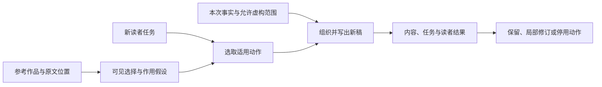

# 文字版 REA：技术路线、工作机制与当前方案

资料截至2026年10月18日。本文综合已核资料和本项目使用记录，面向需要判断“怎样把参考作品变成可用写作方法”的读者。

当前方案是：把参考中的具体选择提炼成有适用条件的动作，用新材料重新组织文章，再检查读者任务是否完成。V2已提供这套候选流程和写作示例。规则、作者向量、分节生成和训练可以承担不同工作；选择它们时，要看输入是什么、怎样进入生成、结果由什么证据判断。

本文的方案取舍是结合本项目目标作的设计判断。外部论文和项目分别支持局部机制及其研究范围，尚未共同证明这套组合的效果。

## 一、从一篇参考文到一篇新稿

假设有一篇解释清楚的技术文章。读者希望借它的长处，写另一项技术。系统首先要分清：参考文章提供观察写法的材料；新技术的文档和用户事实支撑新稿断言；现稿是本轮实际修改的对象；用户反馈说明哪些位置或作用需要调整。同一文件可以兼有多个角色，但每个角色需要单独说明。

观察时，可以从一段具体文字入手：它先回答哪个问题，随后补了哪个条件，最后把什么交给下一段。比如一份解释沿着“使用者需要什么→参与者要准备什么→条件怎样接上→最终能交付什么”推进。可复用的动作是沿对象与交接解释关系。换题以后，段落中的主体、条件和结果都必须由新材料重新提供。

这一步需要留住原文位置。仅写“逻辑严密、短句有力、富有感染力”，执行者不知道下一稿该改变什么。更具体的记录可以是：第二段先给直接答案，第三段展开两条不同路径；作用假设是帮助读者先定位问题，再理解过程。网站版式、题材特点或目标读者原有知识，也可能解释这种安排。它们构成竞争解释，防止把一次观察写成普遍规律。

逆向结果随后进入新任务。执行者先问新读者是否也有这个问题，再查材料能否给出答案。若新题只有分类关系，就选择适合分类的结构；若确有过程但缺中间证据，就补查或收窄。源文章的具体段落顺序可以启发提问，不能自动决定新题也要出现同样的公司、人物或章节数量。

一个具体例子是：参考[上升流短文](https://oceanservice.noaa.gov/facts/upwelling.html)时，可以观察它怎样连起“表层水移走、下层水补位”的过程。迁到海盐解释时，改用[新事实材料](https://oceanservice.noaa.gov/facts/whysalty.html)，把“雨水作用于岩石、溶解成分进入河流、河流汇入海洋”连起来。新稿采用了过程组织，事实仍来自海盐材料。这个示例复用P008的开发材料，只展示迁移动作，没有单独测其阅读效果。

上图表示候选工作流程。当前Skill依靠执行它的模型完成这些判断，图中的箭头尚不是一套会自动阻止错误流转的软件状态机。

## 二、用三个可组合的选择理解技术路线

现有材料可以按三个轴比较。第一是怎样表示写法：用显式规则、可解释统计或学习到的向量。第二是怎样组织生成：一次生成、按段推进，或用计划和控制器约束当前内容。第三是怎样更新能力：调整规则和示例，或者构造数据、训练模型参数。评价贯穿三轴，检查表示是否适用、生成是否守住内容、更新是否带来退步。

| 选择 | 输入和中间对象 | 主要能控制什么 | 使用前要具备什么 |
|---|---|---|---|
| 显式机制与示例 | 原文位置、段落职责、条件化动作 | 解释顺序、论证动作、局部语气与编辑范围 | 有可观察参考；执行者能理解并应用规则。 |
| 可解释统计 | 分词、断句、长度、标点与特征计数 | 发现某些表面分布偏差 | 统计适配语言，单位、分母和覆盖范围明确。 |
| 写法表征与条件生成 | 参考文本编码后的向量、新内容 | 在模型支持的范围内调节目标写法 | 匹配的编码器、生成器与训练分布。 |
| 计划与分节生成 | 全文目标、章节职责、前文状态 | 覆盖、衔接、当前事件和后续展开 | 分节确有必要，相关材料实际进入每次调用。 |
| 数据与参数训练 | 有来源的输入、目标稿、反馈和过滤记录 | 让已学能力进入生成器或评价器参数 | 适用数据、资源、来源分组及独立评价。 |

表中的后两项可与前面几项组合。例如，一个系统可以用显式提纲确定章节，用向量提供局部写法条件，再按前文状态逐节生成。组合后的输出仍需重新检查，不能因为每个组件分别有论文支持，就把组合当成已验证产品。

本项目当前优先使用显式机制、按需研究和分节写作。这样可以回到原文讨论某条动作是否成立，也能定位改动的范围。向量和训练路线保留为研究选项，等任务、材料和评价需求证明它们解决了当前流程难以解决的问题，再决定是否引入。

## 三、写法怎样表示，内容怎样留下来

### 1. 显式机制卡承担可解释的迁移

女娲从多类材料提炼表达和判断模式；Style Distiller把观察组织为可调用的合同、共同结构与变体；Quill提供分维度组合的设计线索。迁到文字REA后，这些方法帮助把“参考很好”变成“在什么条件下采取哪个动作”。一条卡片需要能回到原文、解释候选作用，并说明在新稿里怎样执行及怎样发现失败。[女娲固定版](https://github.com/alchaincyf/nuwa-skill/blob/7812110bf7e5a2b01b6aa5a738568044121bbfa2/SKILL.md)、[Style Distiller](https://github.com/Guan-Yep/style-distiller/blob/4a288008bf3491b75ab3c203f05f4058065c60fb/SKILL.md)、[Quill](https://github.com/sevenwoood/quill-skill/blob/23b58b48e72675b0b2ad035b7d098653d8f503fd/SKILL.md)。

显式卡片的长处是可修改：若某个收束句在解释文里重复前文，可以只改该处动作；换成长篇教学时，它又可能承担必要提醒。卡片过多也会占用上下文，并使执行者把每个参考的局部习惯都当义务。因此当前写作动作页按读者的断点取用，允许原稿合适时不改，也允许提出库中没有的动作。

多参考需要分工。一个参考帮助组织解释链，另一个帮助安排叙述距离；两者都不自动贡献新稿事实。若两份参考争夺同一位置，应按新题需要选择。没有可解释的分母和计量方式时，“七成像甲、三成像乙”只能作为偏好输入，执行时仍须落成可观察的取舍。

### 2. 向量给模型提供条件，仍需核它表示什么

TinyStyler把目标写法表征作为生成条件，同时输入待迁移内容；其方法包含候选构造、筛选和训练。多篇参考可用于形成目标表示。这提供了另一种控制接口：执行者不必把全部写法都写成自然语言规则，但需要匹配的表征和生成模型。[TinyStyler](https://arxiv.org/html/2406.15586v2)。

向量相近要结合训练目标理解。作者相同可能意味着话题、载体或时期也相近；这些因素会混进“写法”信号。StyleDistance利用受控的内容与写法组合训练和评价表征，多语扩展包含中文并处理部分不适用特征。它们提供了检查解耦与语言适配的思路，句级表征结果仍不足以证明一位中文作者的长文能被稳定重建。[StyleDistance](https://arxiv.org/html/2410.12757v2)、[mStyleDistance](https://arxiv.org/html/2502.15168v1)。

内容保留和写法匹配需要不同参照。前者回到本次事实与必须传达的内容，后者才回到参考写法。若某个分数实际比较候选与参考，即使名称含“语义”，也不能据它判断候选保住了新材料。表征系数改变了生成条件，也不直接表示全文有多少百分比采用某种写法。

### 3. 属性控制和任务目标要对齐

StyleRemix为作者身份模糊化设计可组合的风格属性和适配器。它启发我们把改动范围写清，并在组合后检查联动：调正式度可能同时影响句长、信息密度和语气。其研究目标与本项目的可用性目标不同，不能把作者识别更困难直接当作文字更好。[StyleRemix](https://arxiv.org/html/2408.15666v1)。

中文还需要自己的统计口径。英文词、汉字、字符与token有不同计数方式；一个只匹配拉丁字母的词统计，可能漏掉大部分中文。返回零不代表全文没有该特征。统计和向量都可以帮助发现偏差，最后仍要读回人物、否定、条件、阶段与因果是否符合本次允许的变化。

## 四、研究与长文生成怎样衔接

长文会把输入选择、资料查找、结构规划和写作连接起来。一节正文所需的证据可能来自多个来源，写作中也可能发现提纲分错了问题。当前流程因此先写必要问题，再给问题找证据，研究结果可以修改结构。

STORM用相邻主题和不同视角启发提问，再围绕资料形成提纲与文章。可迁移之处是把“可能漏了什么”变成具体待答问题。多个角色名称并不能证明覆盖，也不能把模拟提问写成真实专家采访。[STORM](https://aclanthology.org/2024.naacl-long.347/)。

资料进入写作前，还需判断每份来源能支持哪条断言。作者项目页可以说明项目怎样自述，公开论文可以说明其方法与实验设置，论坛反馈可以提供失败线索。几篇文章若都来自同一公告，增加了网址也没有增加独立支持。遇到争议，应比较具体主张、条件和依据，而不是给所有说法安排相同篇幅。

研究后的提纲要有章节职责。某节要解释对象怎样运行，就需要过程与条件；某节要比较路线，就需要共同分类轴和适用范围。材料丰富但与职责无关时，不必全写。搜不到关键证据时，可以补查、收窄或保留未决；不能让一个空标题自动扩成貌似完整的事实段落。

分节生成还需要前文状态：哪些信息已讲、哪些术语已定义、前面提出的问题是否兑现。LongWriter中的AgentWrite把分段计划、当前步骤和累计正文传给后续写作，论文也报告了重复和频繁总结等问题。这个机制说明上下文衔接有实际输入成本，生成长度和阅读质量需分别检查。[LongWriter定稿](https://proceedings.iclr.cc/paper_files/paper/2025/file/59f278de1619bdb6b53fd04e8e0976e0-Paper-Conference.pdf)。

给每节分配篇幅可以帮助安排重要程度，实际计数仍需在成稿后完成。当前任务的硬范围不能用一个宽松长度分替代。补字数时，应先找未讲清的关系、缺的例子或必要条件；若这些都完成了但仍未达硬范围，就查清是否有内容缺口或要求冲突，保留未达状态，不自行降低原范围，也不靠重复段落掩盖。

流程实现也要追到实际调用。参数名、接口字段和计划日志只能说明某项内容被声明，不能证明写作步骤看到了它。本项目对STORM固定分节模块的静态核读，就发现部分提纲字段没有继续进入下一调用；这里没有运行其系统或测量输出损失。[固定模块](https://github.com/stanford-oval/storm/blob/fb951af7744dab086e34962e9bc6fe878e145f83/knowledge_storm/storm_wiki/modules/article_generation.py)。

对于当前十份文档组成的Skill，这一点也同样具体：执行者若只读入口，没有按任务读迁移或关系指南，不能事后靠把参考文件附上来声称已经执行。保留实际读到的输入和生成版本，才能判断某次失败来自材料、选取、改写还是仍无法定位。

## 五、文类决定哪些动作合适

### 1. 解释和比较围绕读者尚缺的关系

解释文可以先定位答案，再走完一个对象的变化；比较文则让多个方案回答同一决策问题。例如，若一组虚构选型材料明确说团队主要在无网现场工作，两个方案应先在这个条件下比较。某个方案有自动同步，只有在相应联网条件成立时才构成当前优势。这个例子的作用是展示条件怎样进入取舍，不是对真实产品作推荐。

结尾需要完成本段职责。它可能给出建议、限定或承接下一节，也可能在关系已讲清时停下。解释稿里重复前文的一句，在教学手册里可能承担提醒；动作是否适用，要看读者此处缺什么。当前动作页给出完整示例，让执行者能看到动作进入正文后的形态。[写作动作与示例](text-rea-v2/references/writing-actions.md)。

### 2. 小说可以构造事件，个人记录要保留事实归属

DOC把故事计划细化为层级事件、场景与人物，并用训练过的控制器约束生成。它对当前内容和未来展开的分工提供了线索；原论文的英语故事片段比较，不能直接代表中文回忆录效果。[DOC](https://aclanthology.org/2023.acl-long.190/)。

迁成写作动作后，可以先明确片段开始时的局面、人物看到什么、作了什么选择、结尾发生什么变化。允许虚构的任务中，这些事件可以创作；在真实个人叙事中，动作、心理、当时知道的信息和时间关系都需要材料支持。照片能支持画面所见，不能独自支持当时动机。今天的回望可以进入文章，但要使读者读得出是谁在什么时候作判断。

已有事实按主题排列时，仍需留意相邻句产生的暗示。两张照片可能属于不同日期，两家公司各有产品也未必存在合作。先写清现稿会让读者认作什么关系，再查原材料，比只核每句名词是否存在更接近真实阅读路径。

### 3. 口述整理先确定目标语体

CS2W研究中文口语到规范书面表达，提供问题片段与直接改写相互对照的线索。真实聊天和回忆材料还需要区分口头重启、强调、情绪、语病和转录疑点。删掉所有口语并不能自动完成个人表达任务。[CS2W](https://aclanthology.org/2023.emnlp-main.241/)。

用户要保留说话感觉时，可以整理断裂结构，同时保住有效强调和犹豫；用户要会议纪要时，则按记录用途压缩。自我修正可能是撤回、替代或补充，不能一律只留最后一句。人名和数字听不清时，应保留不确定性并按授权核查，而不是根据音近生成一段完整事实。

## 六、当前V2实际提供的工作流程

当前可移用版本是[第二十二轮Skill包](文字版REA_V2_Skill包_第二十二轮.zip)，包含十份Markdown。它提供由模型执行的逆向、迁移、研究、写作和审查说明；没有附带训练权重或独立运行服务。普通写稿可以直接完成，只有需要逆向与迁移时才展开相关部分。

| 当前工作 | 对应材料 | 应产出的具体结果 |
|---|---|---|
| 识别任务与材料角色 | [入口](text-rea-v2/SKILL.md)、[协议](text-rea-v2/references/protocol.md) | 谁来读、用来做什么，哪些是参考、事实、现稿和反馈。 |
| 观察作品或多样本 | [语料与画像](text-rea-v2/references/corpus-profile.md) | 有原文位置的选择、分组条件、支持与反例，不把口述或助手稿冒充本人书面作品。 |
| 重建作用和正文 | [迁移指南](text-rea-v2/references/transfer.md)、[写作动作](text-rea-v2/references/writing-actions.md)、[长文研究](text-rea-v2/references/research.md) | 适合新材料的结构、章节职责与完整稿件。 |
| 核关系与任务结果 | [关系核验](text-rea-v2/references/relation-checks.md)、[Harness](text-rea-v2/references/harness.md) | 事实与关系缺陷、是否回应要求、可接受性、偏好与仍待核的内容。 |
| 改稿与改方法 | [迭代与选版](text-rea-v2/references/iteration.md)、[证据说明](text-rea-v2/references/evidence-notes.md) | 保留原判和败例，说明本次改的是稿件、执行方式还是可复用规则。 |

动作库是这套流程的候选索引。执行者仍应从本次参考取得位置和选择，才可以说某条机制由该文逆向而来；缺少原文支持时，只能把它作为编辑提案。八张卡和三个教学示例增加了可阅读的用法，没有增加八项独立验证。

当前方法可以把改动具体到一个段落、一项关系或一个未回答的问题。它也依赖执行模型的判断：模型可能漏读条件、误解指令，或把评价提案当成用户要求。增加字段和文档不能替代真实使用。必要时记录实际输入、版本和失败阶段，可以让下一次修改更有依据。

## 七、已有证据与评价应怎样读

评价至少要回答三个问题：是否执行了指定修改、候选能否用于本题、在候选之间更想用哪一稿。它们可能给出不同结果。一个标题已经重命名，未必适合章节职责；一稿更短，也可能删去读者需要的解释。

WritingBench按题生成评价标准并经过人工复核，启发我们让判法回到当前要求。标准的名称、说明和分档仍需核适用性，模型提出的要求不能自动变成用户硬约束。历史人机一致性研究只能支持其设置下的结果。[WritingBench v4](https://arxiv.org/html/2503.05244v4)。

公开标签也需要来源身份。LitBench主要配对标签由Reddit票数经时间和长度等条件筛选而来，另有新生成故事的人工阅读研究。社群代理信号、直接读者选择和模型评分各自记录，不能只看到chosen字段就当作逐对人工评阅。[LitBench](https://arxiv.org/html/2507.00769v1)。

| 本项目记录 | 当前证据 | 可以支持的判断 |
|---|---|---|
| P001月食解释 | 用户最初首选乙，来自已有通用流程；后续选修订候选A更自然 | 有局部自然度偏好；生成未隔离，不能归因V2优势，也没有首次理解成绩。 |
| P004口述试写 | 单路三版，首两版未达篇幅，第三版321汉字，进入320–420范围 | 有完整使用和失败轨迹，尚无作者整稿接受或方法比较。 |
| P006英文规程 | 450词完整单稿，来源要求由同一作者自查 | 有局部内容保留记录；没有执行重建，也没有工程师实际操作结果。 |
| P008多参考试写 | 三篇机构参考、一篇反例与新题完整稿；一次修订 | 有局部画像到成稿过程；同源开发材料，未证明稳定机构写法。 |
| H003段落评价校准 | 十二组先锁定再揭示；三组暂缓，四候选待核 | 暴露可接受性、领域内容和相对偏好的分歧；不是生成效果或中文全文评价。 |

这些记录中，P001的首选基线值得保留。新方法要帮助使用者完成任务，就需要和已有有效流程正面比较；给V2增加名称、卡片或来源数量，都不能代替这个比较。

若声称“更好懂”，应先按来源和读者任务定问题，检查候选是否提供作答依据，再收首次读者的实际答案。找到对应句、读者觉得顺，以及读者能准确复述关系，是不同观察。同题看过旧稿以后再读新稿，已有暴露也要记录。

若研究创作体验，可以让读者比较同条件匿名稿，并分别说明整体选择与某项偏好。两稿都不可接受时，仍可能存在相对首选。作者参考改稿提供编辑证据，也可能依赖未给系统的领域背景，不能自动成为唯一真值。[ParaReval数据卡](https://huggingface.co/datasets/taln-ls2n/parareval)。

方法选版还需要看代价。若某流程让稿件更接近可用，但使用者要多轮删改和补证，成本可能抵消部分收益。实际计时、修改轮次和遗留问题应与质量并列；没有实测时，保留未知，不用文字更短来推测更省时间。

## 八、怎样产生下一个更强版本

当前最需要的证据是同条件生成比较。直接写、已有通用流程和文字REA应看到相同任务、事实与相同的参考权限，并保留各自实际读到的方法、首稿、修订和评阅记录。如果一条路线多拿了范文或原始证据，比较就同时改变了材料与方法，无法单独说明哪项造成差异。

已经准备的P003、P005分别固定了自己的方法快照，尚未派发独立生成。它们以后产生的结果只属于实际使用的版本。若要比较当前第二十二轮，需要另定对应任务和输入，不能把更新后的规则悄悄放进旧组。当前独立助手调用仍缺明确授权，这项状态继续保留；本报告属于同一主助手的完整使用记录。

比较后，先判断失败属于哪里。事实不在材料里，可能需要研究；材料有而未取到，可能要调整输入选择；已取到却改坏，才回看具体动作；如果规则合理但没有执行，应修执行方式。没有中间证据时，成因保持未定。新增一条通用规则并不能自动修复这些不同问题。

方法候选也可以删减。某个动作只在解释文有效，就保留其条件；某条指令反复诱发重复，可以收窄或移出当前路线。选版材料一旦参与修改，就属于开发或选择过程；后续泛化需要另有保留材料。原文的多个段落、同题多个模型回答和同一读者多次阅读都要按共同来源分组。

如果以后进入训练，应先定义要让模型学会什么：稳定保留新内容、在指定维度接近参考，还是更可靠地判可接受性。数据可以保存输入、参考角色、目标稿、反馈与过滤依据；教师生成的解释也需要核实。训练写作者和训练评价器是不同任务，不能让一个评分器反复挑选自己最喜欢的输出后，再用同一分数证明泛化。

这里的训练路线属于未来设计。当前“蒸馏”已完成的是显式规则与示例提炼，尚无本项目参数训练结果。有关模型生成Skill效用的研究也说明，阅读两份Skill的文字并预测哪个会更有效，与实际下游执行是不同证据。[Skill效用研究](https://arxiv.org/html/2605.23899v1)。

现阶段可直接使用第二十二轮候选包：从当前读者问题挑适用动作，把源文观察落到新材料，写出完整稿，再把真实失败留作下一轮依据。要宣称“更强”，仍需实际比较、足够的任务覆盖和读者结果。这个要求约束结论的范围，也决定下一阶段应把精力放在哪里。

---

本文取材于[来源总账](文字版REA_来源总账_20261018.csv)中已核相关方法及本地使用记录，共131条来源登记，其中58条核过方法或指令相关内容。它是对所选路线的综合技术报告，没有声称穷尽所有中文英文资料；原始深度、关联来源和未决项继续保留在总账与各轮记录中。
